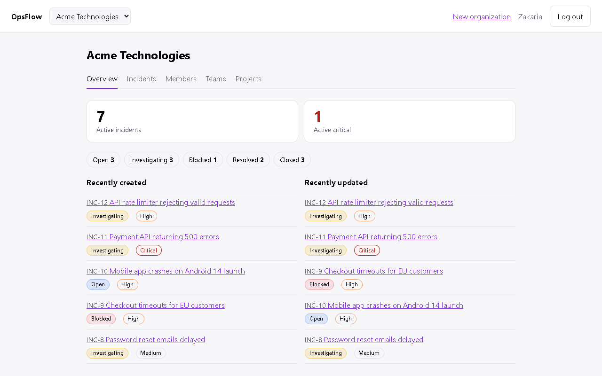
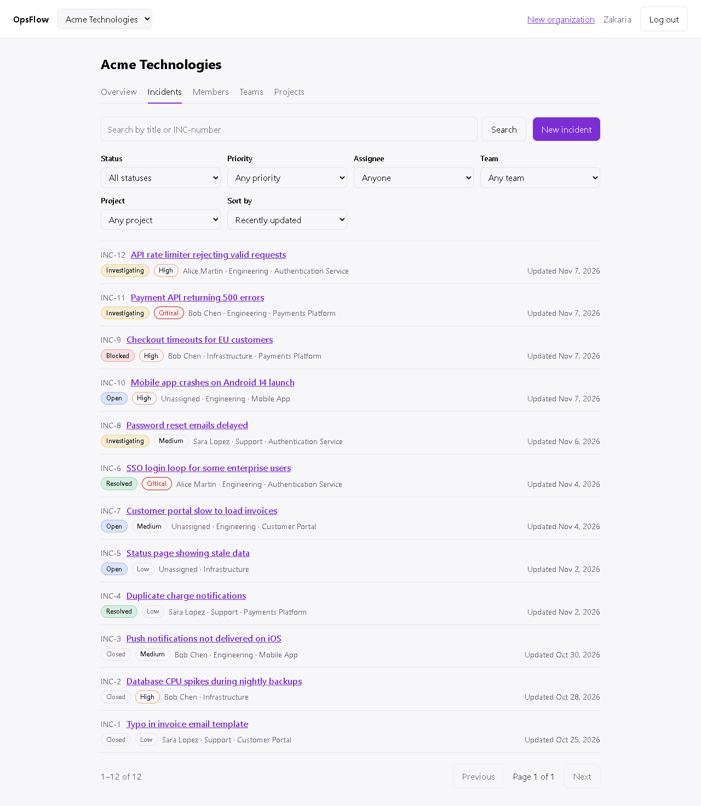
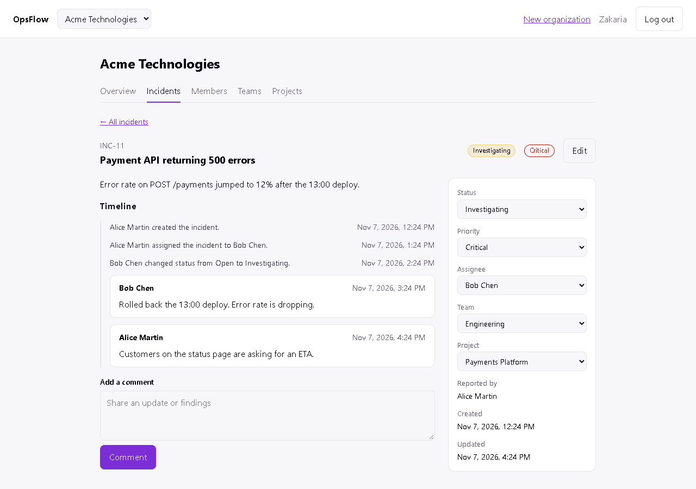

# OpsFlow

[](https://github.com/BilalSh1/opsflow/actions/workflows/ci.yml)

OpsFlow is a multi-tenant incident-management app for engineering, support and operations teams. Organizations report incidents, assign them to people and teams, work through a status workflow, discuss them in comments and keep a full history of every change.



| Incident list | Incident timeline |
| --- | --- |
|  |  |

## Features

- **Organizations and roles**: users belong to any number of organizations as Owner, Admin, Member or Viewer. Owners and admins manage members, teams and projects; viewers are read-only.
- **Incidents**: numbered per organization (`INC-12`), with priority, an optional project, an assignee and a team.
- **Status workflow**: Open → Investigating ⇄ Blocked → Resolved → Closed, with reopening. Only valid transitions are offered, and resolved and closed dates are set automatically.
- **Comments and activity**: one timeline per incident, recording who changed what and when ("Alice changed priority from High to Critical").
- **Incident list**: filter by status, priority, assignee (including "assigned to me" and "unassigned"), team and project; search by title or number; sort; paginate. Filters live in the URL, so views can be shared.
- **Dashboard**: active and critical counts, incidents by status, and recently created and updated incidents.
- **Teams and projects**: group members into teams; archive projects instead of deleting them once they have incidents.

## Tech stack

| Layer | Technology |
| --- | --- |
| Web | React 19, TypeScript, Vite, React Router |
| API | Node.js, NestJS 11, TypeScript, class-validator |
| Database | PostgreSQL 17, Prisma 7 |
| Auth | Argon2 password hashing, JWT access tokens, rotating refresh tokens in httpOnly cookies |
| Tests | Jest (API), Vitest and Testing Library (web) |
| Tooling | Docker Compose, ESLint, Prettier, GitHub Actions |

## Architecture

```text
React (Vite) ──REST /api/v1──▶ NestJS ──Prisma──▶ PostgreSQL
```

A few decisions worth highlighting:

- **Tenant isolation on the backend.** Every organization route runs the same guard chain: access token → organization membership → role permission. Non-members get `404`, not `403`, so ids cannot be probed. Every query is also scoped to the organization in the URL, so an incident, team or project id from another organization behaves as if it does not exist.
- **One permission table.** Roles map to permissions such as `incidents:update` or `members:manage` in one place on the API; the web app mirrors it only to hide controls.
- **Refresh-token rotation.** Login sets an httpOnly, `SameSite=Strict` cookie holding a random secret, of which only a SHA-256 hash is stored. Each refresh replaces it; presenting an already-used token revokes all of that user's sessions. The web app shares one refresh request per tab and serializes tabs with a Web Lock, so normal use never trips that protection.
- **Safe concurrency.** Incident numbers come from a counter on the organization incremented inside the create transaction. Role changes and incident updates lock the relevant row, so an organization can never lose its last owner and status changes apply one at a time.
- **History that survives change.** Activity entries store readable values (names, not ids), so the timeline stays meaningful after people leave or teams are renamed.

The original design documents are in [`docs/`](docs): [product requirements](docs/product-requirements.md), [MVP scope](docs/mvp-scope.md), [architecture](docs/architecture.md), [database design](docs/database-design.md) and the [development plan](docs/development-plan.md).

## Getting started

Requirements: Node.js 22.22 or newer, and Docker.

```bash
# 1. Database
cp .env.example .env            # then set POSTGRES_PASSWORD
docker compose up -d postgres

# 2. API (http://localhost:3000/api/v1)
cd apps/api
cp .env.example .env            # use the same password in DATABASE_URL, and set JWT_ACCESS_SECRET
npm ci
npm run prisma:generate
npx prisma migrate deploy
npm run db:seed                 # optional demo data
npm run start:dev

# 3. Web (http://localhost:5173)
cd ../web
npm ci
npm run dev
```

The dev server proxies `/api` to the API, so the app and API share an origin locally.

### Demo data

`npm run db:seed` (in `apps/api`) creates the organization "Acme Technologies" with teams, projects and twelve incidents in different states. It can be rerun at any time and only replaces its own demo data. Log in with any of these accounts; the password is `OpsFlowDemo123!`, or whatever `SEED_DEMO_PASSWORD` is set to when seeding.

| Role | Email |
| --- | --- |
| Owner | `demo-owner@example.com` |
| Admin | `demo-admin@example.com` |
| Member | `demo-member@example.com` |
| Member | `demo-support@example.com` |
| Viewer | `demo-viewer@example.com` |

## Development

| Command | `apps/api` | `apps/web` |
| --- | --- | --- |
| Start | `npm run start:dev` | `npm run dev` |
| Test | `npm test` | `npm test` |
| Lint | `npm run lint:check` | `npm run lint` |
| Type check | `npm run typecheck` | included in `npm run build` |
| Build | `npm run build` | `npm run build` |

After changing `prisma/schema.prisma`, run `npm run db:migrate` and `npm run prisma:generate` in `apps/api`.

CI runs lint, type checks, builds and tests for both apps on every pull request, and applies all migrations and the demo seed to a fresh PostgreSQL database.

## Project structure

```text
apps/
  api/                 NestJS API
    prisma/            schema, migrations, demo seed
    src/
      auth/            register, login, refresh, logout, access-token guard
      organizations/   organizations, members, membership guard, permissions
      teams/  projects/  incidents/   one module per domain
  web/                 React app
    src/
      api/             typed API client with silent token refresh
      features/        auth, organizations, incidents (state, rules, helpers)
      pages/           routed screens
docs/                  requirements, scope, design notes, screenshots
```
